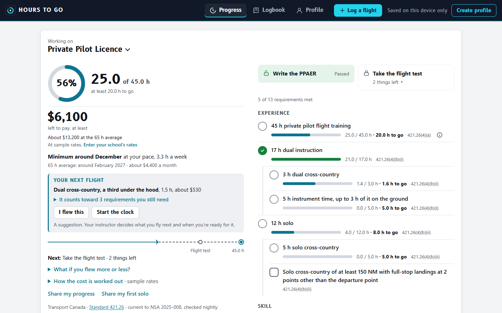
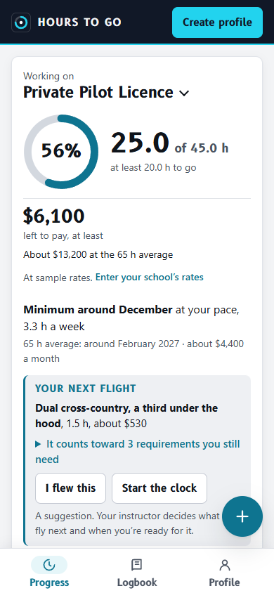
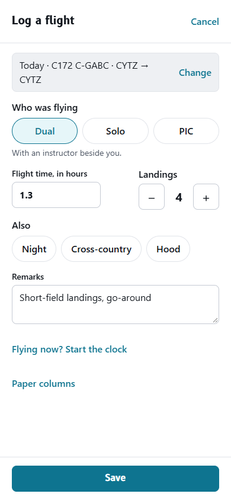
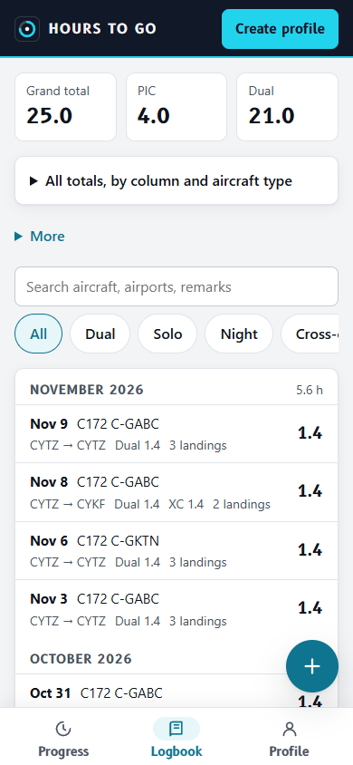
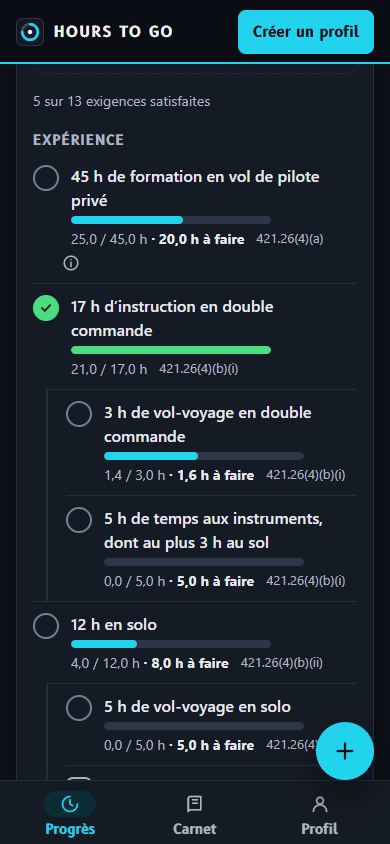
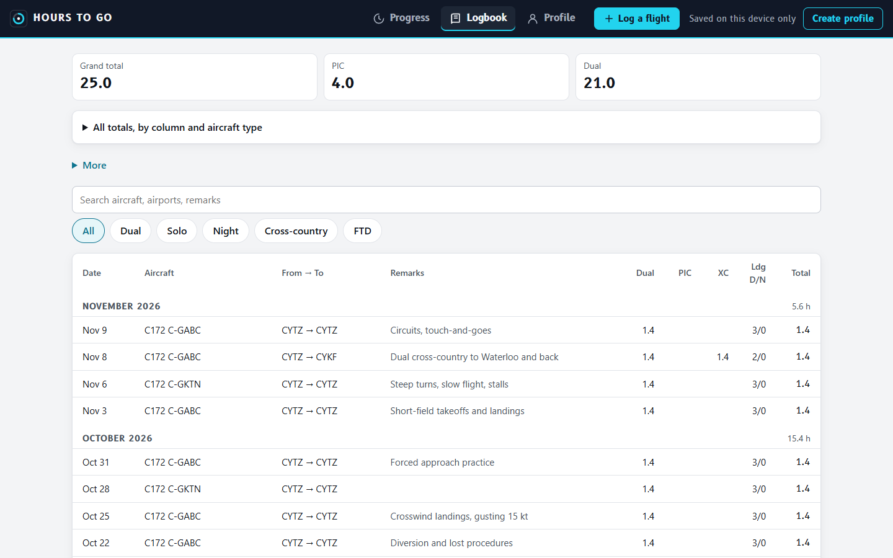
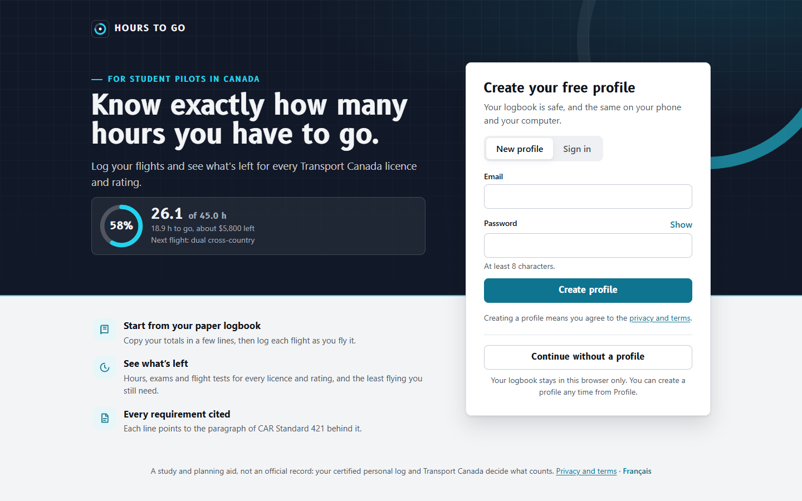

# Hours to Go

A pilot logbook that tells you what is left for each Transport Canada licence and rating.

<picture>
  <source media="(prefers-color-scheme: dark)" srcset="docs/screenshots/progress-dark.png">
  
</picture>

Each logbook line has the same columns as a Canadian pilot's personal log: single- and
multi-engine time by day and night (dual, PIC, co-pilot), cross-country day and night (dual, PIC),
actual IMC, hood, FTD, IFR approaches, and day and night takeoffs and landings. Paper totals go in
the same boxes, one line per aircraft type if you want totals by type. For every licence and
rating the app shows each requirement, how much you have, how much is left, what is unlocked
(writing the exam, booking the flight test), and the paragraph of the standard it comes from.

It runs in a browser on a computer or a phone, in English or French, light or dark, and can be
added to a phone's home screen. It is published at <https://nberkyilmaz.com/hours-to-go/>;
[docs/deploy.md](docs/deploy.md) says how. Without an account the logbook is saved in that browser
only. With a free profile (email and password) it is saved on the server and is the same on every
device. Anything logged before signing up moves into the new profile.

<p>
  
  
  
  
</p>

The pictures use a made-up student's logbook.

## What it does

The D-numbers point to the decisions in [docs/decisions.md](docs/decisions.md) that explain each part.

**Progress**

- How far along you are, by hours, toward the licence or rating you're working on (D47, D64).
- What the least flying left costs at your school's aeroplane, instructor and simulator rates, with
  the arithmetic shown. Sample rates stand in until you enter yours (D39).
- When you'll have it flown at the pace of your last 8 weeks, what that pace costs a month, and a
  slider for flying more or less (D40, D51, D58).
- Your next flight: the one that would count toward the most of what is left, with "I flew this"
  to log it. Your instructor decides what you fly (D43).
- Every requirement with its bar and its paragraph of the standard, and a note wherever the app had
  to interpret the text (D2, D3, D67).
- What runs out stops counting: a written exam, a flight test, the medical (D44).
- For a licensed pilot, whether they're current to fly under CAR 401.05: the last 5 years, recurrent
  training, passengers by day and at night, and the instrument check and approaches (D52).

**Logging**

- A quick form: who was flying, the time and the landings, then night, cross-country or hood. The
  paper columns are one tap away and stay the record (D46).
- A flight clock that keeps running with the app closed or no signal (D59), and "Log this flight
  again" for a lesson flown many times (D51).
- Paper totals in one entry, with a few questions about what their columns can't show (D20).
- The logbook by month, with search and filters, and the remarks in their own column on a wide
  screen (D48, D69).



**Keeping and sharing**

- A spreadsheet in and out (D54), a full backup as a file, and the logbook printed in a paper log's
  columns or saved as a PDF (D55).
- A read-only link that shows an instructor your progress, but not your logbook lines (D56).
- A picture to share for a first solo, halfway, the last requirement and a licence held. It is made
  on the device and nothing is uploaded (D61).
- Reminder emails before the medical, an exam or recurrent training runs out, once you turn them
  on (D53).
- It opens and logs with no signal, and saves when the connection comes back (D41).
- Every night a check compares the parts of Standard 421 the app cites with Transport Canada's page,
  and opens an issue if one has changed (D42).

**A first visit** opens on a welcome that shows what the app does and recommends a free profile.
Going on without one is a tap (D27, D49).



## Licences and ratings covered

All from [CAR Standard 421](https://tc.canada.ca/en/corporate-services/acts-regulations/list-regulations/canadian-aviation-regulations-sor-96-433/standards/standard-421-flight-crew-permits-licences-ratings-canadian-aviation-regulations-cars),
aeroplane category, text current to NSA 2025-008 (effective 2025-12-17).

| Goal | Standard | Written exam unlocks | Flight test unlocks |
| --- | --- | --- | --- |
| Private Pilot Licence | 421.26 | Cat 3 medical, ground school, letter, 5 h flight time | 35 of the 45 h training (421.14(4)(a)) |
| Night Rating | 421.42(1) | — | — |
| VFR Over-the-Top | 421.44 | — | — |
| Commercial Pilot Licence | 421.30 | Cat 1 medical, ground school, letter, 50 h (25% of 200 h) | 150 h, 75% of 200 h, and CPAER passed (421.14) |
| Multi-engine Class Rating | 421.38(3) | — | — |
| Instrument Rating Group 3 and Group 1 | 421.46 | Cat 3 or 1 medical, 5 h instrument flight or ground time | Every knowledge and experience item (421.14(4)(d)) |
| Flight Instructor Class 4 | 421.69 | Cat 1 medical, ground school, letter, 25% of the 30 h training | Every knowledge and experience item |
| Airline Transport Pilot Licence | 421.34 | Cat 1 medical, 375 h (25% of 1500 h) | 1125 h, 75% of 1500 h |

Every written exam (PPAER, CPAER, INRAT, SAMRA, SARON, AIRAF) shows a "Can you write it yet?"
checklist from 421.13: the medical, the recommendation letter where one is needed (PPAER, CPAER,
AIRAF; dated within 60 days), the share of experience in the table above, and photo ID on the day.

The INRAT prerequisite was changed on 2024-10-10 to **5 hours of instrument flight or ground
time**. Older material and some schools still talk about needing half of the 40 hours first.

### Where the standard needed interpreting

Each of these choices is also shown as a note next to the requirement in the app.

- **Paper totals in one entry**: the "total to date" line goes in box for box, and a few questions
  cover what its columns can't show. *How much of your PIC time was solo?* (all, none, or some
  by day, night and cross-country), *how many of the night takeoffs & landings were solo?* when the
  totals also hold night dual, and, for a pilot who holds a PPL, *how much was flown after it?* (none,
  all, or a short breakdown). Nothing else is asked, because the night rating and IFR count every
  hour regardless of which course it was flown in.
- **Solo**: the personal log keeps solo time inside the PIC columns, but the PPL, night rating and
  CPL count solo separately. A single flight has a "Solo flight" tick box. Solo requirements that
  fall short say how much PIC time in the log isn't counted as solo.
- **Grand total** adds the ten flight-time columns only. Cross-country, actual IMC and hood are part
  of that same time, logged again. FTD time is instrument ground time and is never flight time.
- **Dual instrument time**: the log doesn't say whether instrument time was dual, so on each line it
  counts as dual up to that line's dual time. Hood time under a safety pilot on a PIC line is
  instrument time but not dual. FTD time is counted as given with an instructor.
- **CPL commercial training** (the 65 h: 35 dual and 30 solo) counts flights from the day your PPL
  was issued, and from paper totals only the part you said came after it. Totals that don't say
  are counted in full, with a note asking you to answer. You can move the start date for each pilot.
- **IFR 15 h dual instrument flight time** counts aeroplane time only. Simulator time already
  counts toward the 40 h as ground time (up to 20 h). Ask your FTU if they credit simulator dual here.
- **Night rating 10 h dual instrument** counts every dual instrument hour in the log, including
  PPL training. The standard says it must be on top of the 10 night hours.
- **Credits**: a night rating covers the CPL night items, an instrument rating covers the CPL
  20 h dual instrument and the whole VFR OTT, and INRAT passed once counts for Group 3, Group 1 and the ATPL.
- **ATPL (c)**: 100 h of PIC cross-country beyond the first 100 h. The standard also accepts co-pilot
  cross-country, but the personal log has no column for it, so it isn't counted.
- **What runs out**: a written exam after 24 months, a flight test after 12 where the standard says so, the
  medical at the valid-to date you enter. A dated item stops counting the day after (D44).
- Lines saved by the first version of the app (one role per line) are moved into these columns when read.
- Not modelled yet: PIC under supervision (ATPL), helicopters and other categories, Group 2,
  foreign and military credits, and the 12-month flight review that can stand in for the 5 years
  of recency (CAR 401.05(1)(b)).

This is a study and planning aid, not an official record. The certified personal log and
Transport Canada decide what counts.

## Project documents

[docs/](docs/README.md) holds the worklog (every phase, problem and fix), the design decisions and
their reasons, the architecture, the Standard 421 text as read, the runbook, and the roadmap.
Read them before changing anything.

## Running it

Needs Node 22.13 or newer. There is nothing else to install: on a laptop the database is
[PGlite](https://pglite.dev), Postgres compiled to WebAssembly, kept in `data/pglite`.

```sh
npm install
npm run dev:api     # API on http://127.0.0.1:8787
npm run dev:web     # app on http://localhost:5173, /api is proxied to the API
```

To try it on your phone on the same Wi-Fi, run `npm run dev:web -- --host` and open the
"Network" address it prints.

The published site is in two parts: the page on GitHub Pages and the API on Render, with
accounts and logbooks in Neon Postgres ([docs/deploy.md](docs/deploy.md)). On a machine you
control, one process can serve both:

```sh
npm run build
NODE_ENV=production DATABASE_URL=postgres://… PORT=8787 npm start
```

| Variable | Default | |
| --- | --- | --- |
| `PORT` | 8787 | |
| `HOST` | 127.0.0.1, or 0.0.0.0 in production | |
| `DATABASE_URL` | `data/pglite`, except in production | A `postgres://` URL, or a folder for PGlite, or `memory://` for a throwaway one. Production refuses to start without it, so a host's wiped disk can never take the profiles with it. |
| `ALLOWED_ORIGINS` | none | Pages on another origin allowed to call the API with the pilot's cookie, comma-separated: `https://nberkyilmaz.com` in production. |
| `NODE_ENV` | | `production` marks the session cookie Secure, so serve over HTTPS. |
| `RESEND_API_KEY` | none | Sends the password-reset email through Resend. Without it, in production, resetting answers "isn't available yet"; in development the email is printed in this terminal. |
| `MAIL_FROM` | `Hours to Go <no-reply@nberkyilmaz.com>` | The reset email's sender, on a domain verified in Resend. |
| `APP_URL` | `http://localhost:5173/`, except in production | The page the emailed link opens: `https://nberkyilmaz.com/hours-to-go/` when published. |
| `FEEDBACK_TO` | `owner@localhost`, except in production | Where "Send feedback" and error alerts go: `contact@nberkyilmaz.com`, from `render.yaml`. Without it, in production, sending feedback answers "isn't available yet" and failures are only logged. |
| `REMINDERS_KEY` | none | The key a daily GitHub Actions run sends to `POST /api/reminders/run`. Without it, turning reminders on answers "aren't available yet" (D53). |

And for building the page (`npm run build`):

| Variable | Default | |
| --- | --- | --- |
| `VITE_BASE` | `/` | The path the page is served from: `/hours-to-go/` when published. |
| `VITE_API` | the page's own server | Where the API is: `https://hours-to-go-api.nberkyilmaz.com` when published. |

## Tests

```sh
npm test            # requirement rules, logbook data, server API, and the app in jsdom
npm run typecheck
```

The API tests run on PGlite. With `TEST_DATABASE_URL` set to a Postgres server they run there
too, on tables they drop first, so never point it at a database you want to keep. CI does this
on every push.

## How it is put together

- `src/rules/goals.ts`: every requirement, with its citation. This is the file to check against the standard.
- `src/rules/evaluate.ts`: turns a logbook into have / need / unlocked for each goal.
- `src/rules/`: also the hours on the ring (`progress.ts`), the price (`cost.ts`), the finish date (`pace.ts`),
  the next flight (`next.ts`), current to fly (`currency.ts`), what reminders say (`reminders.ts`), and what an
  instructor's link shows (`shared.ts`).
- `src/model/entry.ts`: the logbook line and its columns (times in whole minutes so totals are exact),
  and the figures each line contributes (`derive`).
- `src/model/store.ts`, `profile.ts`: the profile, file parsing, and merging a device's log into a profile.
- `src/model/quick.ts`: the quick form, turned into the same columns. `csv.ts` and `printlog.ts`: the spreadsheet
  and the printed log.
- `src/i18n/`: the French, one entry per English phrase (D57).
- `src/useLogbook.ts`, `src/model/sync.ts`: where the logbook lives. Signed in, changes show at once, are
  kept on the device, and go to the server in order; with no connection they wait (D41). As a guest,
  changes go to localStorage.
- `src/sw.js`: the service worker that keeps the app on the device, so it opens with no connection.
- `scripts/standard.ts`: every night, compares the sections of Standard 421 the app cites with Transport
  Canada's page, and opens an issue if one has changed (D42). `npm run standard:check` does it by hand.
- `server/`: Fastify API, scrypt password hashes, HttpOnly session cookies (90 days from the last
  visit), Postgres (Neon in production, PGlite on a laptop and in tests).

## Not done yet

- A native app-store app. The web app installs to the home screen instead.
- Instructor accounts, and an instructor seeing logbook lines or signing them off (D56).
